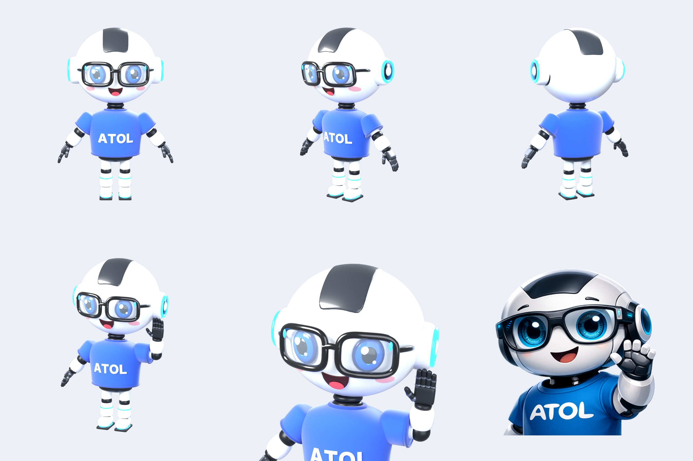
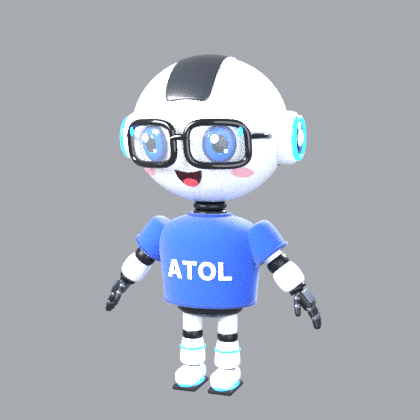

# Robot ATOL en 3D

Modèle 3D complet (de la tête aux pieds) de la mascotte robot ATOL, riggé pour l'animation et le motion design.

## Fichiers

| Fichier | Usage |
|---|---|
| `robot_atol.blend` | Scène Blender 4.0+ : mesh `ATOL_Robot`, rig `ATOL_Rig`, actions `Hello` et `Idle` |
| `robot_atol.glb` | glTF binaire (mesh skinné + 2 animations) : web, Three.js, After Effects (via plugin), Unity, etc. |
| `robot_atol.fbx` | FBX : Cinema 4D, Maya, Unreal, Unity |
| `build_robot.py` | Script qui génère tout le modèle (modifiable puis relançable) |
| `render_previews.py` | Rendus de prévisualisation (Cycles) |

Régénérer : `blender -b -noaudio --python build_robot.py`

## Rig

- Pièces rigides pondérées à 100 % sur un os (comportement "robot", pas de déformation molle).
- Os : `root`, `hips`, `spine`, `chest`, `neck`, `head`, `shoulder/upper_arm/forearm/hand.L/R`,
  doigts `index/middle/ring/pinky/thumb_01/02.L/R`, `thigh/shin/foot.L/R`.
- Contrôles d'expression :
  - `eye.L` / `eye.R` : échelle **Z** → clignement (0.1 = œil fermé).
  - `mouth` : échelle **Z** → ouvrir/fermer la bouche, échelle **X** → largeur du sourire.
- Rolls symétriques : copier/coller de pose en miroir (Ctrl+Shift+V) fonctionne.
- Rotation **X** locale = flexion du coude, du genou, des doigts.
- Pose de repos en A-pose (bras à 40°), 1 unité = 1 m (hauteur ≈ 2,1 m), le robot regarde vers −Y.

## Matériaux

Principled BSDF simples (compatibles glTF/FBX) : blanc laqué, panneau gris foncé, articulations noires,
t-shirt bleu + impression « ATOL » en relief, LEDs bleues émissives (oreillettes, lunettes, tibias, bottes),
verres transparents, joues roses semi-transparentes.
